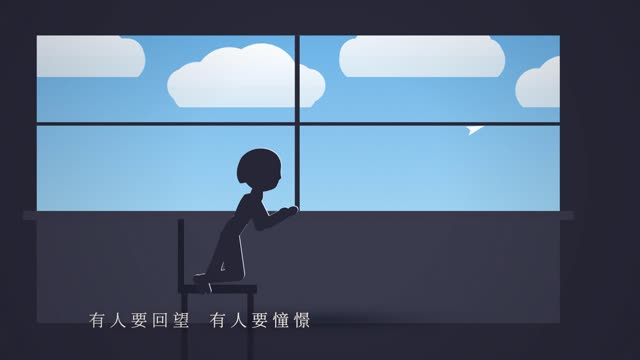

# 窗花 · 《世界赠予我的》

**王菲《世界赠予我的》MG 动画 MV —— 一扇窗花，看着一个女孩长大、变老**

  

 

## ✨ 亮点

- ✂️ **程序剪纸**：对称团花、鱼、囍字都由代码生成，还能“展开”
- 👧 **会长大的人物**：剪影骨架按年龄连续变化，发型、裙长、身高平滑生长
- 🧣 **布料模拟**：红围巾用行波加双面布，静止下垂、奔跑翻飞
- 🎤 **逐字歌词**：CTC 模型估算 227 个字的起点，保留拖音与停顿

## 🖼️ 剧照

<table>
  <tr>
    <td width="50%"></td>
    <td width="50%"></td>
  </tr>
  <tr>
    <td width="50%"></td>
    <td width="50%"></td>
  </tr>
</table>

## 🎧 关于音乐

> [!NOTE]
> 这是**非官方同人作品**，歌曲版权归原作者及唱片公司所有。仓库里只有画面源码，**不含音频和歌词文件**。
>
> 想在本地运行，请自备正版音频，放到 `assets/song.flac`（音乐）和 `assets/lyrics.lrc`（歌词）。只想看成片的话，直接去 [Releases](https://github.com/OxMianBaoxO/world-gift-mv/releases/latest) 下载 MP4。

---

王菲《世界赠予我的》的 MG 动画 MV。全片在网页里用 Canvas 一帧帧实时画出来：镜头按小节排，歌词使用本机音频生成的逐字时间，保留演唱中的拖音和停顿。

故事：一扇贴着窗花的小窗，看着一个女孩长大、变老。除夕夜外婆剪了一条红纸鱼贴上窗；女孩围着红围巾举着风车奔跑、在山顶接住一捧星光，夏夜听蟋蟀、躲雷雨，病过一回又好起来，离家、长大，在海边遇见爱人，成家、生子，回赠外婆一张自己剪的窗花；老了以后，她把红围巾围在孙辈脖子上，一家人放起孔明灯，灯化成星，连成外婆剪的那条鱼。又是一年，她成了剪窗花的人。

## 怎么看

- 双击 `播放MV.cmd`：会启动本地服务器（端口 8797），并用默认浏览器打开。
- 也可以在本目录运行 `node tools/serve.mjs 8797`，然后打开 http://127.0.0.1:8797/ 。
- 不要直接双击 `index.html`：用 file:// 打开时，浏览器不让读取音乐和歌词文件。

快捷键：空格 暂停 · F 全屏 · ← → 快退快进 5 秒 · 1～5 跳到主歌一 / 副歌一 / 主歌二 / 副歌二 / 尾声 · D 显示镜号与帧率 · [ ] 调整音画偏移（每次 20 毫秒）

## 素材

- `assets/song.flac`：录音室版（Apple Music 的 ALAC 无损，转成 FLAC，浏览器才能播放）。
- `assets/lyrics.lrc`：你提供的歌词文件。歌词文字只从这个文件读取，代码里不写歌词；开头的署名行（词、曲、编曲、制作人）用在片名和片尾。
- 字体用系统里装好的思源宋体（Noto Serif SC）和华文行楷，没有打包进工程。

## 文件

| 文件 | 内容 |
|---|---|
| `js/shots-1.js` | 前奏 + 主歌一：一点光、小星球、外婆剪窗花、年夜烟花、举着风车奔跑、金色光带、星河入手、雪停在半空、牵手回家、窗花鱼游进梦里 |
| `js/shots-2.js` | 副歌一 + 间奏：冬去夏来、草尖萤火、蟋蟀与声波、闪电、荷叶当伞、雨后新月、鱼形星座、病中、阳光与风铃、白色空间、金线与水彩、四季星球、抵达海边 |
| `js/shots-3.js` | 主歌二 + 副歌二：海堤吉他、山寺撞钟、被吹走的围巾、浪潮、单车载她、落日牵手、贴囍、婚礼、抱着新生儿、回赠窗花、金线画窗、瓦片搭屋顶、毛笔写名、门框刻度、灯下读书、雪夜一窗灯 |
| `js/shots-4.js` | 尾声 + 尾奏：翻页、浮起的旧照片、窗边的孩子、白云下的一家人、合影定格、红围巾传下去、望海、放孔明灯、满天灯火、灯化成星、又是一年、新的窗花、收成一点光、片尾 |
| `js/figure.js` | 人物：侧面剪影骨架、步态、IK、各年龄比例（会长大、会变老）、头发、红围巾 |
| `js/papercut.js` | 程序生成的对称剪纸：团花、鱼、囍，可以“展开” |
| `js/world.js` | 场景积木：镜头与视差、小星球、小镇、雪地、屋里、床、祥云 |
| `js/props.js` | 屋子、窗、灯笼、风车、孔明灯、风铃 |
| `js/draw.js` | 绘图库：光晕、星空、银河、云、山、雪雨萤火花瓣、烟花、声波、风线、光束、海 |
| `js/type.js` / `js/lrc.js` | 歌词排版（横排 / 竖排、逐字出现）与 LRC 解析 |
| `js/director.js` | 导演：按小节排镜头、转场（淡、擦、圆形开窗、经色）、歌词层、颗粒与暗角 |
| `js/audio-data.js` | 音频特征与节拍（`tools/analyze.mjs` 生成，约 62 BPM，4/4） |
| `js/lyric-timing.js` | 18 句、227 字的绝对秒数时间表，只含逐字起点与分段结尾 |
| `tools/align-lyrics.py` | 用本地 WeNet CTC 模型及同音字概率估算逐字时间，结果先写入缓存供审阅 |
| `tools/apply-lyric-alignment.mjs` | 应用已审阅的逐字结果，补偿模型发射延迟；尾句重点起音另经波形校准 |
| `tools/check-lyric-timing.mjs` | 检查全部字符的时间顺序、停顿、退场和尾句完整显示 |
| `docs/分镜脚本.md` | 59 个镜头的时间、对应的歌词句号与画面 |
| `tools/shoot.mjs` | 在独立的无头 Edge 里截帧、拼联系表、测帧耗时 |

截帧检查：`node tools/shoot.mjs sheet 0 60 2`（0～60 秒每 2 秒一格，图在 `.cache/shots/`），`node tools/shoot.mjs list` 打印镜头表。

2026-10-25 歌词校时：改为逐字起点，修正第 4 句和尾句被能量分段误判的长停顿，取消尾句 16 拍截断；逐字入场最长缩短到 0.22 秒。时间来自 CTC 估算及重点波形核对，尚未完成全曲逐字人工试听验收。原版本保存在 `backups/before-lyric-sync-20261025-210144/`。旧的 `tools/vocal-timing.mjs` 现在只输出能量粗估到缓存，不会覆盖播放用时间表。

2026-10-26 细节打磨：围巾改成行波 + 两面布（静止下垂、走路轻摆、奔跑翻飞），被风吹走、递还、传给孙辈的围巾也换成同样的布带；长大改成分季平滑生长，发型（马尾→披发）、裙长、发髻都是连续参数；门框刻度那镜每拍平滑长高；浪潮改成短波长尖浪峰带白沫；重画钟亭（重檐、青铜钟、吊绳撞木）和灯塔（灯室、扫过海面的光束）；房屋积雪只积上半坡、加木构、小镇高低错落；叠化/经色/擦除转场设了时长下限，雪夜镜头改为直接叠化。

2026-10-26 衔接与穿帮：单车后座改成侧坐透视（大腿缩短、小腿收起、手搂腰），车轮转速与地面同步；雪停前后两刀、牵手回家→卧室（推进窗口）、海堤→山寺（横移转场 slide）、围巾被吹走→浪潮、围巾传给孙辈→望海、小星球→新的窗花（推进窗口）都改成连续镜头。

---

用代码一帧一帧画出来的 MV · 由 <a href="https://github.com/OxMianBaoxO">@OxMianBaoxO</a> 制作

